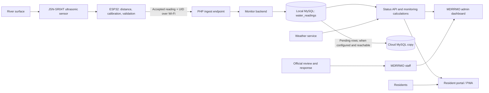

c# Daguitan Bridge Flood Monitoring System
## Panel Presentation and Live Demonstration Guide

Use this guide to present the complete system as one connected story: **measure the river, validate the reading, store it safely, interpret the risk, and get useful information to the people who need it.**

This is a presentation playbook, not a claim that every deployment dependency is production-ready. Confirm the checklist at the end before presenting. In particular, the ESP32 sketch currently contains prototype calibration/network settings, and the cloud database defaults to a local development schema until a hosted database is configured.

---

## 1. The one-sentence explanation

> The Daguitan Bridge Flood Monitoring System uses an ESP32 and an ultrasonic sensor to measure river level, sends accepted readings to a local monitoring platform, calculates trends and threshold status, and presents the information to MDRRMO staff and residents, with cloud synchronization designed to copy records when connectivity is available.

## 2. Suggested presentation timing

Plan for approximately **12 minutes, plus the panel's questions**.

| Part | Time | Purpose |
|---|---:|---|
| Opening and community problem | 1 min | Explain why timely, understandable river information matters |
| Solution and system flow | 2 min | Show how the sensor, software, database, and people connect |
| IoT hardware and measurement | 2 min | Demonstrate the physical sensor-to-ESP32 step |
| Web system and data | 2 min | Show live status, reading history, and the two user roles |
| Controlled end-to-end demonstration | 3 min | Follow one safe test reading from sensor to screen |
| Limits, safety, and next steps | 1 min | Be precise about calibration, connectivity, and warning authority |
| Questions | Remaining time | Answer with evidence from the prototype |

If the panel gives you less time, keep the opening, system-flow diagram, one end-to-end reading, and honest limitations. Do not rush through five pages of menus.

---

## 3. Presentation storyline

Keep the explanation in this order:

1. **The need:** Water conditions can change, and people responsible for response need timely, shared information.
2. **The measurement:** A non-contact ultrasonic sensor measures the distance to the water surface.
3. **The validation:** The ESP32 converts distance to a prototype water-level value and checks unusual changes against consecutive readings.
4. **The transmission:** The ESP32 sends an accepted reading and unique record ID to the PHP ingest endpoint over Wi-Fi.
5. **The record:** The backend validates the request and saves it to the local MySQL `water_readings` table.
6. **The interpretation:** The platform derives trend, rate, estimated time-to-threshold, and a color status from configured water-level thresholds.
7. **The people:** MDRRMO staff review monitoring and history; residents use the portal for status, advisories, weather, and preparedness information.
8. **The resilience design:** The local application can retain readings during cloud-connectivity problems; queued rows can be copied later when the cloud target is reachable.
9. **The safety boundary:** The system supports awareness and decision-making. MDRRMO remains responsible for official warnings and evacuation instructions.

### System flow diagram



The local PC/server, local MySQL, Wi-Fi/LAN, and Apache/PHP need to be available for local-first ingestion. Internet/cloud availability is a separate part of the path.

---

## 4. Slide-by-slide plan and speaker notes

### Slide 1 — Title

**Daguitan Bridge Flood Monitoring System**

*IoT-Based River-Level Monitoring and Community Information Platform*

Include your institution, proponents, adviser, and date. Keep the slide uncluttered: project title, one clear photograph of the prototype, and a small location label are enough.

**Say:**

> Good day. We are presenting a prototype flood-monitoring system for Daguitan Bridge. It connects an IoT measurement device with a monitoring platform intended to help MDRRMO staff and residents see river-level information and relevant advisories.

### Slide 2 — The need

Use three short points, supported by a local problem statement you have verified:

- River conditions need to be observed and communicated clearly.
- Manual observation and disconnected records can make it harder to share a consistent update.
- Staff and residents need information that is visible, timestamped, and understandable.

**Say:**

> Our focus is not to replace the people responsible for flood response. It is to provide a shared, timely record that can support their monitoring and communication.

Do not state casualty, flood-frequency, accuracy, or response-time statistics unless you have a reliable source and can cite it on the slide.

### Slide 3 — Our solution at a glance

Show the chain as five large, readable blocks:

**SENSE → VALIDATE → STORE → INTERPRET → INFORM**

Underneath, label the components:

- **Sense:** JSN-SR04T ultrasonic sensor
- **Process:** ESP32 firmware
- **Receive:** PHP / CodeIgniter API
- **Store:** local MySQL; cloud copy when configured and reachable
- **Present:** MDRRMO dashboard and resident portal

**Say:**

> We designed the system as a complete information flow, not only a sensor display. Each stage has a specific responsibility, from the physical measurement through to how people review the result.

### Slide 4 — IoT hardware and measurement

Show a clean, labeled photograph or diagram of the actual bench prototype:

- JSN-SR04T sensor pointed at a controlled target/water surface
- ESP32 controller
- Trigger and echo connections
- Correct echo voltage divider if the sensor echo output is 5 V
- Power supply and Wi-Fi/LAN route to the local PC

**Explain the measurement simply:**

> The ultrasonic module measures the distance from the sensor to the water surface. The system subtracts that distance from a measured reference height to estimate water level. The ESP32 checks abrupt changes before it accepts and sends the value.

**Important:** The current sketch labels its reference height as a temporary development value (`200 cm`). Measure and calibrate the real installation before treating a displayed value as a field measurement. Do not claim a certified accuracy unless you have test results against a calibrated reference.

### Slide 5 — What happens to one reading?

Animate or reveal these steps one at a time:

1. Sensor measures distance.
2. ESP32 converts it into a water-level reading using the reference height.
3. Validation classifies a sample as accepted or pending confirmation.
4. ESP32 sends accepted water level, distance, and a unique record ID.
5. API checks the device key and saves the reading locally.
6. Admin and resident screens request updated status.

**Say:**

> In our demonstration, we will follow one accepted reading rather than jump between features. The serial output is the device-side evidence; the API response confirms receipt; the history screen confirms storage.

An HTTP `200` and `ok: true` indicate the API accepted the request. Explain `stored: local` as local-database storage—not as proof of cloud delivery.

### Slide 6 — From readings to useful status

Show one uncluttered sample status panel and define each item:

- **Water level:** the calculated measurement
- **Trend:** rising, steady, or falling based on recent readings
- **Rate:** observed change over time
- **Estimated time-to-threshold:** a conditional estimate when water is rising
- **Warning band:** green, yellow, or red based on configured water-level thresholds
- **Reading time / sensor status:** helps staff distinguish recent telemetry from stale last-known data

**Say:**

> The trend, rate, and estimated time are analysis aids; they are not guarantees. The color band is based on configured water-level thresholds. Weather information is supplementary and does not by itself determine the river warning band.

Threshold and sensor-reference values in the prototype are development settings. Present them as **sample configuration** unless MDRRMO has formally validated the field values.

### Slide 7 — Local-first and cloud-copy design

Show two separate storage boxes:

```text
ESP32 → PHP/API → Local MySQL (primary capture)
                              └→ Cloud MySQL (copy when configured/reachable)
```

Explain the failure cases accurately:

- If internet/cloud connectivity is down but the ESP32 can still reach the local PC over LAN, local capture can continue and pending cloud copies can wait.
- If the ESP32 cannot reach the local server, its firmware queue can retain up to 24 readings in device flash and retry; the current firmware drops the oldest unsent entry when the queue is full.
- When the server is reachable again, queued device readings can be posted. Pending local database rows can be retried to the configured cloud database.
- A cloud copy is a separate database destination. A second schema on the same local XAMPP installation is useful for development, but it is not an off-site cloud backup.

**Current project state to disclose:** the repository defaults to a local development cloud schema. Do not claim that off-site cloud sync is operating until a hosted MySQL database is configured and a successful sync is demonstrated.

### Slide 8 — Two views, two audiences

Split the slide into two columns:

**MDRRMO administrator**

- Current monitoring status
- Sensor/connectivity indicators
- Historical readings and filters
- Analytics, alerts, announcements, and reports
- Manual cloud-sync control and sync status

**Resident portal**

- Flood status and last reading time
- Trends and supplementary weather information
- Announcements and safety guidance
- Evacuation-center map and preparedness tools

**Say:**

> Staff need review and management tools; residents need the essential status and practical guidance. The system presents information according to those different needs.

Avoid showing real resident phone numbers, login details, notification tokens, or personal reports to the panel.

### Slide 9 — Safety, roles, and responsible use

- The prototype provides monitoring information; it does not independently issue an official evacuation order.
- MDRRMO reviews information and follows approved local operating procedures.
- Residents should follow official instructions from authorized responders.
- Stale readings must be clearly identified as last-known readings.
- Weather forecasts and estimated time-to-threshold are supplementary, uncertain information.
- Escalation/notification channels should only be described as operational if they are configured and tested in the demonstration environment.

**Say:**

> The system is intended to support human decision-making. Official warnings and evacuation decisions remain with authorized local officials.

### Slide 10 — Validation and next steps

Use a simple “tested / needs validation / next” table:

| Area | What to say |
|---|---|
| API and local record flow | Demonstrate the actual accepted reading and its history entry |
| Sensor calibration | Field reference height and comparison measurements must be documented |
| Warning thresholds | Validate with MDRRMO and local bridge/reference measurements |
| Offline behavior | Demonstrate separately on the bench; document what remains local and what queues |
| Hosted cloud database | Configure and test a real remote destination before claiming remote backup |
| Notifications and response | Show only channels that have a working end-to-end test and approved recipients |

Finish with:

> Our next phase is to calibrate the prototype against a trusted reference, validate thresholds with MDRRMO, test connectivity-loss and recovery, and complete the deployment configuration before field use.

---

## 5. Clean, controlled live-demo plan

### Before the panel arrives

- Charge and power the ESP32; check the ultrasonic wiring and echo voltage level.
- Confirm the sensor has a safe, stable target. Never manipulate a real bridge or waterway to create a dramatic reading.
- Start Apache and MySQL; open the correct project URL and sign in to the demo admin/resident accounts.
- Confirm the ESP32 can reach the PC's **LAN IP** and ingest endpoint.
- Open Arduino Serial Monitor at the sketch's configured baud rate.
- Open the resident portal and admin **Live Monitoring** or **Monitoring History** in separate tabs.
- Confirm the current reading timestamp and station status; if the sensor is offline, either repair the demo path or label the display clearly as last known.
- Confirm the admin/history view contains a recent test reading and the API accepts the test key.
- Hide passwords, API keys, Wi-Fi details, browser password prompts, personal resident data, and unrelated tabs.
- Close notifications that contain private names/details. Do not use personal production accounts for the public demo.
- If internet access is unreliable, prepare screenshots/video of a **clearly labeled earlier test**. Never imply a recording is live.

### Three-minute demonstration

**0:00–0:30 — Identify the hardware**

> This is the ultrasonic sensor and ESP32. The sensor measures distance without touching the water, and the controller processes the reading.

**0:30–1:00 — Show device-side output**

Point to the distance, converted water level, validation status, and queue count. Explain what each line means. Use a controlled target change if safe and practical; do not manufacture a flood alarm.

**1:00–1:30 — Show API acknowledgement**

Show the `HTTP 200` response and point out `ok`, `record_uid`, and `stored`. Explain:

> This confirms the application received the reading and stored it locally. It does not by itself prove that an off-site cloud copy succeeded.

**1:30–2:00 — Show the admin**

Open Live Monitoring, then History. Locate the matching latest reading/time or record count. Explain that stored readings support review beyond the current dashboard card.

**2:00–2:30 — Show the resident view**

Open the resident dashboard. Point out warning band, water level, trend, last reading time, and the visible stale/offline state if the sensor is not sending current data.

**2:30–3:00 — Explain resilience and responsibility**

Describe the local-first path and the tested status of the cloud destination. End by stating that authorized MDRRMO personnel—not an unreviewed sensor or ETA—make official response decisions.

### Optional offline/recovery demo

Run this only in a controlled lab with a prepared rollback and a test database:

1. Record the starting queue/sync counts.
2. Simulate loss of **cloud** connectivity while leaving the ESP32-to-local-server LAN path available.
3. Send one safe test measurement and show that it is recorded locally and marked pending for cloud copy.
4. Restore cloud connectivity and run the sync worker/admin sync action.
5. Verify the pending count decreases and the same unique record is present in the destination.

Do not disconnect the ESP32 from the local server and then claim the server received the sample: in that case, only the device queue can retain it until connectivity returns.

---

## 6. What makes the presentation look clean

- Use one consistent palette from the system (deep red, white, charcoal, with yellow/red/green reserved for warning states).
- Use large type and a maximum of 3–5 short points per slide.
- Use the same system-flow diagram throughout instead of redrawing it on multiple slides.
- Use actual, well-lit prototype photos with cables and components labeled; remove unrelated background clutter.
- Use one test reading consistently across Serial Monitor, API response, and database/history screenshots.
- Keep presentation screenshots at a readable zoom; crop out browser clutter and personal information.
- Use a controlled cursor and narrate each click before doing it.
- Keep the resident portal and admin dashboard in separate tabs; avoid logging in/out during the demo.
- Use a visible caption such as **Prototype test reading** on simulated or historical data.
- Have a static screenshot/short screen recording ready if live hardware or internet fails.
- End with a concise “current status and next validation steps” slide; confidence comes from precise, repeatable evidence, not unsupported claims.

---

## 7. Likely panel questions and concise answers

### “How does the sensor measure water level?”

> The ultrasonic sensor measures the distance from the sensor face to the water surface. The configured reference height minus that distance gives the estimated water level. The physical reference height must be measured and the result compared with a trusted gauge before field use.

### “What happens if the internet goes down?”

> The design separates local ingestion from cloud copying. If the ESP32 can still reach the local server over LAN, the local database can keep recording while cloud rows remain pending. If the local server is unreachable, the ESP32 firmware queue stores up to 24 unsent readings in flash and retries later. We demonstrate and report each case separately.

### “Is the cloud backup working now?”

> The code supports a separate cloud database, but the current development configuration points to a local XAMPP schema. We will describe off-site backup as a deployment step until we have connected a hosted database and verified it with a recovery test.

### “How accurate is the measurement?”

> We do not claim a certified accuracy without documented calibration results. We will compare repeated sensor measurements against a reference, record error across the intended operating range, and define acceptable tolerance with the project adviser and MDRRMO.

### “How are the warning colors decided?”

> The warning band is based on configured water-level thresholds. Those prototype values are not presented as official Daguitan Bridge thresholds; they need validation with local measurements and MDRRMO approval. Weather, trend, and estimated time are supplementary and do not by themselves set the warning band.

### “Can the system order evacuation?”

> No. It provides monitoring information and communication tools. Authorized local officials remain responsible for interpretation, official warnings, and evacuation decisions.

### “What if a sensor reading is abnormal?”

> The ESP32 applies consecutive-reading checks for sudden changes before accepting them. We still need systematic field testing for sensor noise, obstruction, mounting, power interruption, and environmental conditions.

### “What prevents duplicate readings after retry?”

> Each queued reading has a record UID. The backend and sync path use that identifier to recognize a repeated transmission instead of treating every retry as a new logical reading.

### “Which SMS provider do you use?”

> We will name the provider only after one is selected, configured, and tested. SMS is an additional channel; we will not claim successful delivery based only on code or an interface.

### “What are the next steps before deployment?”

> Finalize mounting and reference height, compare readings against a trusted gauge, agree on official threshold values, conduct controlled connectivity and power tests, configure a hosted database if remote backup is required, and document MDRRMO review and response procedures.

---

## 8. Final presenter checklist

### Technical

- [ ] ESP32 is powered and connected to the intended Wi-Fi.
- [ ] Sensor target and mounting are stable and safe.
- [ ] Sensor reference height has been checked for the demo setup.
- [ ] Apache, PHP application, and local MySQL are running.
- [ ] ESP32 LAN address/ingest path is reachable.
- [ ] API acknowledgement and matching local history entry are verified.
- [ ] Admin and resident accounts both load the correct screens.
- [ ] Demo warning thresholds are identified as prototype values if not formally approved.
- [ ] Cloud target is described accurately as local development or hosted, as applicable.
- [ ] Offline simulation has been rehearsed and can be rolled back.

### Presentation and privacy

- [ ] No passwords, API keys, Wi-Fi credentials, or notification tokens are visible.
- [ ] No personal resident details are visible on the projector.
- [ ] All screenshots clearly distinguish live data from prior/test data.
- [ ] Backup screenshots/video are ready.
- [ ] Every claimed feature has a visible demo, test evidence, or clear “planned/needs validation” label.
- [ ] The closing slide lists concrete next steps and keeps official decisions with MDRRMO.
